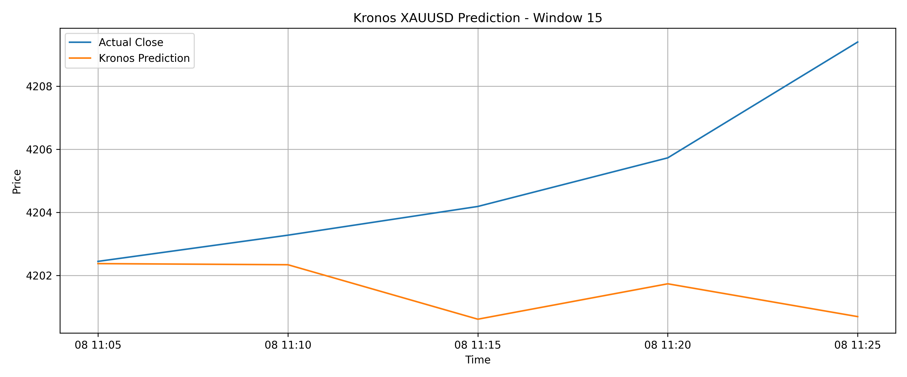
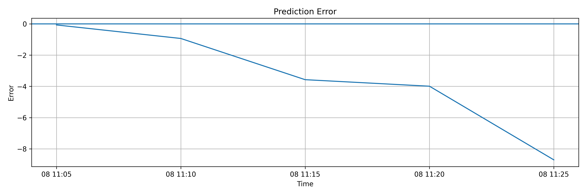
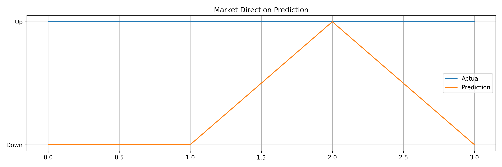

# Kronos XAUUSD Forecasting

## Overview

This project implements a complete forecasting pipeline for **XAUUSD
(Gold/USD) 5-minute candlestick data** using the pretrained
**Kronos-small** financial time-series foundation model.

The pipeline includes:

-   Data preprocessing
-   Zero-shot inference using Kronos
-   Context--horizon configuration analysis
-   Rolling backtesting
-   Prediction generation
-   Quantitative evaluation
-   Forecast visualization

The objective is to evaluate the capability of a pretrained financial
foundation model to forecast future OHLCV candle behavior without
additional fine-tuning.

------------------------------------------------------------------------

# Model: Kronos

This project is based on:

**Kronos: A Foundation Model for the Language of Financial Markets**

Kronos is a financial time-series foundation model designed for
candlestick data. It uses a specialized tokenizer to convert market
information into discrete representations and applies an autoregressive
Transformer architecture for forecasting.

Model components:

-   Model: Kronos-small
-   Tokenizer: Kronos-Tokenizer-base

------------------------------------------------------------------------

# Dataset

## Asset

XAUUSD

## Timeframe

M5 (5-minute candles)

Input features:

-   timestamp
-   open
-   high
-   low
-   close
-   volume

Additional generated features may be used during preprocessing.

------------------------------------------------------------------------

# Data Preprocessing

The preprocessing pipeline performs:

1.  Loading historical candle data
2.  Timestamp conversion
3.  Chronological sorting
4.  Duplicate removal
5.  Missing value handling
6.  Feature preparation
7.  Formatting data for Kronos inference

# Feature Selection and Dataset Adaptation

The original Kronos model uses an additional feature called `amount`. Since this feature was not available in the XAUUSD dataset, it was excluded and the model was evaluated using only the available OHLCV features.

------------------------------------------------------------------------

# Experimental Optimization

Before final inference, different context and prediction horizon
configurations are evaluated.

The optimization process searches for the best balance between:

-   Prediction error
-   Price forecasting accuracy
-   Directional movement accuracy

Evaluation ranking:

  Metric                   Weight
  ---------------------- --------
  RMSE                        40%
  Directional Accuracy        40%
  MAE                         20%

Execution time is not considered in model selection.

------------------------------------------------------------------------

# Best Configuration

The selected configuration is recorded in
[outputs/experiments/best_context_report.json](outputs/experiments/best_context_report.json)
for the `context_horizon_grid` experiment (342 tests).

| Parameter | Recorded value |
| --- | --- |
| `input_size` | 250 |
| `prediction_size` | 5 |
| `step` | 500 |
| `windows` | 100 |

The ranking weights recorded in the report are `RMSE=0.4`,
`Directional Accuracy=0.4`, and `MAE=0.2`; execution time has
weight `0`. “Best” refers to this experiment's weighted ranking,
not to the lowest value of every error metric individually.

Recorded metrics for this configuration:

- MAE: `8.240183671874984`
- RMSE: `9.15800252889457`
- MAPE: `0.1812194282388125`
- Directional Accuracy: `54.5`

------------------------------------------------------------------------

# Rolling Backtest

The final model is evaluated using rolling backtesting.

Each window contains:

    Historical candles
            |
            v
        Kronos Model
            |
            v
     Future candle prediction
            |
            v
     Comparison with real market data

For each window the following are stored:

-   Actual candles
-   Predicted candles
-   Prediction errors

Outputs:

    outputs/backtest/windows/

------------------------------------------------------------------------

# Evaluation Metrics

## MAE

Mean Absolute Error between actual and predicted close prices.

## RMSE

Root Mean Squared Error measuring prediction deviation.

## MAPE

Mean Absolute Percentage Error.

## Directional Accuracy

Measures whether the model correctly predicts market movement direction.

------------------------------------------------------------------------

# Final Results

[outputs/final/metrics.json](outputs/final/metrics.json) records the
following results for `window=15`:

- MAE: `3.4538399999999454`
- RMSE: `4.588045236045331`
- MAPE: `0.08209525750483329`
- Directional Accuracy: `25.0`

In [evaluation/final_evaluation.py](evaluation/final_evaluation.py),
`WINDOW = 15` selects `window_15_actual.csv` and
`window_15_prediction.csv` from `outputs/backtest/windows/`.
It is a backtest window identifier, not a prediction horizon or a count
of evaluated windows. These final metrics describe that selected window,
not an average across all backtest windows.

## Report Comparison

Values below retain the precision recorded in the JSON reports.

| Report / evaluation scope | MAE | RMSE | MAPE | Directional Accuracy |
| --- | --- | --- | --- | --- |
| Context–horizon experiment: selected configuration (`input_size=250`, `prediction_size=5`, `step=500`, `windows=100`) | 8.240183671874984 | 9.15800252889457 | 0.1812194282388125 | 54.5 |
| Final evaluation: selected backtest `window=15` | 3.4538399999999454 | 4.588045236045331 | 0.08209525750483329 | 25.0 |

**Comparison limitation:** These are outputs of different evaluation
procedures with different recorded settings and scopes. The first report
records the winning configuration of the context–horizon experiment;
the second evaluates one selected backtest window. The final metrics
JSON records only the window identifier and metrics, and does not
independently record input size, prediction size, step, or total window
count. Consequently, this table is a side-by-side record, not a
controlled comparison: the lower final MAE/RMSE/MAPE does not establish
an improvement over the experiment, and the directional accuracy
difference does not establish a general performance change. Such a
claim would require evaluation on the same samples with the same
configuration and aggregation procedure; these two reports alone do
not establish those conditions.

------------------------------------------------------------------------

# Visualization

The final forecasting performance of the optimized Kronos model is analyzed through visual comparison between real market behavior and model predictions.

The generated figures are produced from the final evaluation pipeline and are stored in:

```
outputs/final/
```

The visualization package contains three main analysis plots.

---

## Actual Close vs Predicted Close

This figure compares the real XAUUSD closing price with the closing price predicted by the Kronos model over the selected forecasting window.

The plot provides a direct view of how closely the model follows the actual market movement and captures price-level behavior.



---

## Prediction Error Analysis

This figure presents the prediction error over the forecasting horizon.

The error is calculated as the difference between the predicted close price and the actual close price.

A smaller and more stable error range indicates better forecasting consistency.



---

## Market Direction Prediction

This figure evaluates the ability of Kronos to predict the direction of future price movement.

The predicted candle direction is compared with the actual market direction to analyze whether the model correctly identifies upward and downward movements.




------------------------------------------------------------------------

# Project Structure

    Kronos_XAUUSD_Inference/

    ├── README.md
    ├── evaluation/
    │   ├── rolling_backtest.py
    │   └── final_evaluation.py
    │
    ├── kronos/
    │   └── inference.py
    │
    ├── outputs/
    │   ├── experiments/
    │   │   └── best_context_report.json
    │   │
    │   ├── backtest/
    │   │   └── windows/
    │   │
    │   └── final/
    │       ├── metrics.json
    │       ├── prediction_results.csv
    │       ├── forecast.png
    │       ├── error.png
    │       └── direction.png
    │
    └── data/
        └── XAUUSD_clean.csv

------------------------------------------------------------------------

# Running the Project

Run optimized backtest:

``` bash
python evaluation/rolling_backtest.py
```

Generate final evaluation:

``` bash
python evaluation/final_evaluation.py
```

------------------------------------------------------------------------

# Conclusion

This project demonstrates a complete zero-shot financial forecasting
workflow using Kronos on XAUUSD market data.

The workflow combines configuration optimization, rolling validation,
quantitative metrics, and visual analysis to evaluate the forecasting
capability of a financial foundation model.
